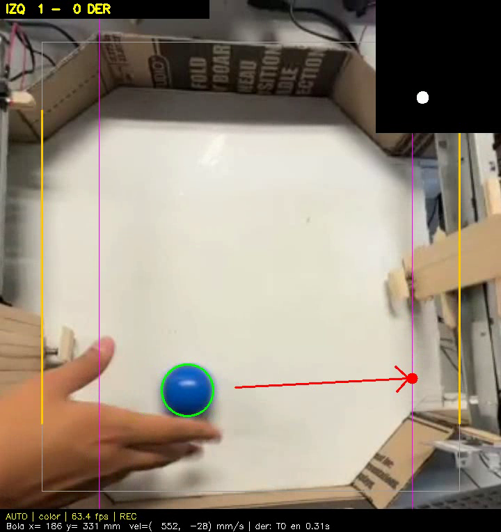

# Porteros Robot

Juego de mesa autónomo inspirado en *Hyperlaps Initial*. Es el proyecto del curso **Sistemas Informáticos en Tiempo Real** (Universidad del Istmo, Ing. Mario Porras).

Dos porteros robot defienden su portería sin ayuda. Una cámara cenital ve la bola y una laptop con Python y OpenCV predice dónde va a cruzar la línea de cada portero. Cada portero tiene un **Arduino Uno con FreeRTOS** que mueve el carro y dispara el solenoide del golpe.



## Estructura

| Carpeta | Contenido |
|---|---|
| `PORTERO_SERIAL/` | Firmware de cada portero (Arduino Uno + FreeRTOS). Es el mismo archivo en los dos. |
| `PORTERO_SERIAL_v1_loop/` | Versión anterior del firmware, sin RTOS (todo en `loop()`). |
| `vision/` | Visión y lógica del juego en Python: `vision_cancha.py` (principal) y `trayectoria.py` (Kalman, rebotes y cruce). |
| `vision/registros/` | Datos de cada sesión grabada (CSV, una fila por foto). Los videos MP4 no se suben por su tamaño. |
| `Documentacion/` | Documento técnico (Word y PDF), diagramas y los scripts que los generan. |
| `PRUEBA_PORTERO/`, `PRUEBA_FINALES/`, `PUSH/`, `control_wasd/` | Pruebas individuales de motor, finales de carrera, solenoide y control manual. |

## Arquitectura

```
Cámara (iPhone + iVCam, 640x480 a 60 fps)
   │
Laptop (Python + OpenCV)
   homografía → bola en mm → Kalman → compensa 0,10 s de latencia
   → cruce con rebotes → objetivo T<mm> y golpe K → goles y marcador
   │  USB serie 115200
2 x Arduino Uno (FreeRTOS)
   tControl  (prio 3): calibración, posición y control del carro; finales de carrera por interrupción
   Temporizador (prio 3): apaga el solenoide al terminar el pulso
   tSerial   (prio 2): decodifica los mensajes de la laptop
   Ociosa    (prio 0): supervisión (watchdogs), pantalla LCD y reportes
```

Protocolo serie: `T<mm>` (objetivo del carro), `K` (golpe), `P<ms>` (duración del golpe), `V<i>,<d>` (marcador en la LCD), `X<texto>` (mensaje en la LCD). El Arduino responde `LISTO` al terminar de calibrar. La tecla `m` en el monitor serie muestra los tiempos de respuesta medidos y la pila libre de cada tarea.

## Hardware

- 2 carros de impresora Epson L120 (riel, banda y motor DC), con finales de carrera en D2 y D3.
- 2 solenoides push de 12 V, cada uno con una paleta de madera.
- 2 Arduino Uno. Un L298N para los motores (D5 PWM, D4) y otro para los solenoides (D9, D10), cada uno con su fuente de 12 V y GND común.
- LCD 16x2 I2C en el Arduino izquierdo (A4, A5).

## Cómo usarlo

1. **Firmware:** abrir `PORTERO_SERIAL/PORTERO_SERIAL.ino` en el Arduino IDE, instalar las librerías **FreeRTOS** (Phillip Stevens) y **LiquidCrystal I2C**, y cargarlo en los dos Uno.
2. **Visión:** conectar la cámara y los dos Arduino (COM6 izquierdo, COM7 derecho; se cambian en `PORTEROS` dentro de `vision_cancha.py`). Luego hacer doble clic en `vision/iniciar_cancha.bat`.
3. Cada portero se calibra solo y responde `LISTO`.
4. En la ventana de la cámara:
   - **K**: recalibrar las esquinas, si se movió la cámara.
   - **N**: marcador a 0-0.
   - **R**: grabar.
   - **A**: modo automático.
   - **L**: recalibrar los carros.
   - **Esc**: salir.

Se necesita Python 3 con `opencv-python`, `numpy` y `pyserial` (el `.bat` los instala).

## Documentación

[`Documentacion/Documento_Tecnico_Porteros_Robot.pdf`](Documentacion/Documento_Tecnico_Porteros_Robot.pdf) incluye:
- requerimientos y decisiones de diseño;
- diagramas eléctrico, de tareas FreeRTOS y de estados;
- el algoritmo de percepción y predicción;
- las pruebas con mediciones de tiempo real;
- el registro de problemas.
